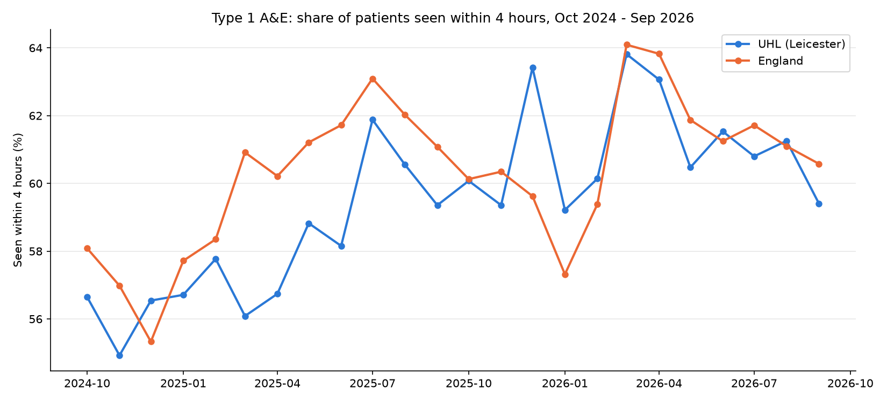

# NHS England A&E Performance — University Hospitals of Leicester vs England

How does **University Hospitals of Leicester (UHL)** perform against the four-hour A&E standard compared with
**England** — and is the usual comparison fair? An end-to-end analysis of 24 months of public NHS England data,
built in **Python** and checked again in **SQL**.

**Author:** Bekir Onal · [LinkedIn](https://www.linkedin.com/in/bekir-onal-636b57250) · [GitHub](https://github.com/bekir35-on)
**Notebook:** [`analysis.ipynb`](analysis.ipynb) · **SQL:** [`queries.sql`](queries.sql)
**Tools:** Python (pandas, Matplotlib, SciPy, requests) · SQLite

---

## Business question
The NHS four-hour standard measures the share of A&E patients who are seen, admitted, transferred or discharged
within four hours. Headline league tables often put Leicester well below the national average. This project asks:

1. Is the headline comparison like-for-like?
2. How has Leicester's performance changed over two years?
3. Is there a winter effect — and what might explain it?

## Data
- **Source:** NHS England, *A&E Attendances and Emergency Admissions* — monthly provider-level CSV files
  (public data, [Open Government Licence v3.0](https://www.nationalarchives.gov.uk/doc/open-government-licence/version/3/)).
- **Period:** October 2024 – September 2026 (**24 months**), the latest revised file for each month.
  The download links are listed in [`data/urls.txt`](data/urls.txt) and downloaded with a Python loop.
- **Combined table:** 4,745 rows × 23 columns (one row per provider per month, plus an England `TOTAL` row).
- **Measure:** four-hour performance = (attendances − attendances over 4 hours) ÷ attendances × 100,
  using **Type 1** (major, consultant-led A&E departments) plus booked Type 1 appointments.

## Key findings

**1. The headline gap is mostly not like-for-like.**
In September 2026, across all A&E types, UHL was **12.3 points** below England (62.1% vs 74.4%). But England's
all-types figure includes Type 3 units (minor injury units and urgent treatment centres), which see patients
faster, and UHL reports no Type 3 attendances. Comparing **Type 1 departments only**, the gap is just
**1.2 points** (59.4% vs 60.6%).

**2. Leicester is improving.**
UHL's Type 1 performance rose from an average of **56.5%** in the first six months to **61.1%** in the last six
(**+4.6 points**); England improved by 3.8 points. Since March 2026 the two lines have moved almost together.



**3. England dips in winter — Leicester does not.**

| Type 1, average | Rest of year | Winter (Dec–Feb) | Change | Mann-Whitney U p-value |
|---|--:|--:|--:|--:|
| England | 61.1% | 58.0% | −3.1 points | **0.0010** |
| UHL | 59.6% | 59.0% | −0.6 points | 0.4537 |
| Gap (UHL − England) | −1.5 | +1.0 | +2.5 | **0.0025** |

England's winter fall is statistically significant; Leicester's is not. Three tests were run, so the
Bonferroni-corrected threshold is 0.05 / 3 ≈ 0.017 — England and the gap still pass. UHL was ahead of England in
6 of the 24 months, and 4 of those were winter months.

**4. Testing two explanations.**
- **Fewer patients? — rejected.** Both saw fewer Type 1 attendances in winter: UHL −5.2%, England −5.5%
  (−3.5% and −3.7% per day, because February has only 28 days).
- **Sicker patients and full beds ("exit block")? — supported.** In winter the admission rate rises slightly
  (UHL 29.5% → 30.7%, England 27.4% → 28.2%), and the share of admitted patients waiting **12+ hours** from the
  decision to admit rises much more nationally (**11.3% → 14.4%**) than in Leicester (**11.8% → 13.6%**).
  This is an association, not proof of cause.

## Data quality
- **Double counting:** each file includes an England `TOTAL` row. The analysis uses that row for England and checks
  that it equals the sum of all provider rows, rather than adding everything together.
- **Inconsistent labels:** the `TOTAL` label was `"TOTAL "` (trailing space) in May 2026 and `"Total"` in
  June–July 2026, so a simple filter found only 21 of the 24 months. Stripping spaces and upper-casing the codes
  fixed it.
- **Python vs SQL:** the monthly results were calculated in both Python and SQL and compared automatically —
  the largest difference was about 10⁻¹⁴ (floating-point rounding), so the two methods agree.

## Method
1. Explore one month (September 2026): structure, missing values, the UHL row (`RWE`).
2. Calculate four-hour performance for UHL and England, then repeat for Type 1 only (fair comparison).
3. Download and combine 24 monthly files; clean text columns.
4. Build the 24-month table and line chart; compare winter (Dec–Feb) with the rest of the year.
5. Test the winter difference with a Mann-Whitney U test (small samples, no normality assumption).
6. Test two explanations: patient numbers, and admissions / 12-hour waits.
7. Load the data into SQLite, rebuild the monthly table as a SQL view (CTE + `CASE` + `GROUP BY`) and the seasonal
   comparison in SQL, and check the SQL results against Python.

## Recommendations
1. **Protect Leicester's winter resilience.** Find out what UHL does differently in winter (for example bed
   management or discharge planning) and keep it.
2. **Track 12-hour waits as an early-warning measure** — they rise when wards fill up, before four-hour
   performance falls.
3. **Report like-for-like comparisons.** Compare Type 1 with Type 1, or with a peer group of similar large
   hospitals, rather than with England's all-types figure.

## Limitations
- Only **two winters** (six months), so the winter findings should be confirmed with more years of data.
- **Association, not cause** — the data cannot show why Leicester copes better in winter.
- **Monthly totals** hide daily patterns such as weekends or flu peaks; no bed-occupancy data is included.
- **One hospital trust and Type 1 only**, so the results may not apply elsewhere. NHS England sometimes revises
  past months; the latest revised files were used.

## Repository structure
```
nhs-ae-analysis/
├── analysis.ipynb        # full analysis, step by step (Python + SQLite)
├── queries.sql           # the SQL view and the seasonal comparison
├── data/
│   ├── urls.txt          # download links for the 24 monthly files
│   ├── ae_2026_09.csv    # September 2026 file used for the first exploration
│   └── monthly/          # 24 monthly CSV files (Oct 2024 – Sep 2026)
├── images/               # charts produced by the notebook
├── requirements.txt
└── README.md
```

## How to run
```bash
python -m venv .venv
source .venv/bin/activate
pip install -r requirements.txt
```
Open `analysis.ipynb` and run all cells. The notebook downloads any monthly file that is missing from
`data/monthly/` and creates the SQLite database `data/nhs_ae.db` (not stored in the repository).

## Next steps
- An interactive Power BI report for monthly monitoring.
- A peer-group comparison with similar large acute trusts, and more years of data.

---

*Bekir Onal — Data Analyst · Python, SQL · Leicester, UK*
